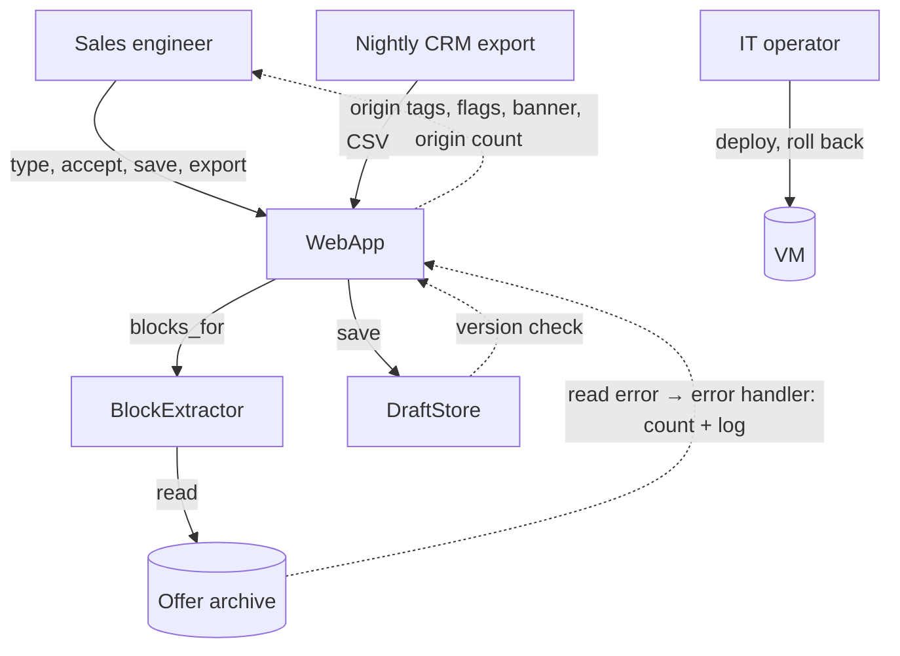
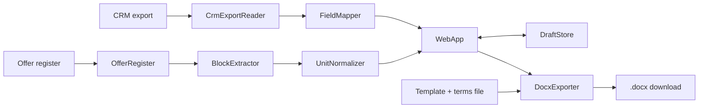
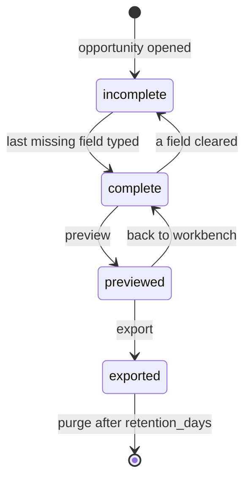

<!-- Example — fictitious Example GmbH. Shows what a finished file looks like; not a template. -->

# OFA Concept — Consolidated Requirements

_Sections 0–12 of the MANIFEST document structure. Together with `30-synthesis.md` (Sections 13–16) this is the source of truth for the feature's code: a fresh agent, given only these files and `CONTEXT.md`, must be able to regenerate the implementation. IDs carry the feature code (`F-OFA-1`) and never change after `done`; reruns append, never renumber._

## 0. Synthesis Context

- **Development path:** mixed — flow, 19-field list, origin pattern and preview retrofitted from the maquette (restated here, not referenced); the rest frontloaded.
- **Synthesis dependencies:** none — OFA is the first feature.
- **Synthesis scope:** the whole feature, from this document, `CONTEXT.md` and `decisions/ADR-OFA-001…003`. The maquette's 19-field list with its CRM column mapping is restated in §10.
- **Field of application:** internal web app (document assistant) — `checklists/requirements.md` Cross-Cutting, Web application, Technology.
- **Scope boundary:** not relevant — pumps are offered, not controlled.
- **System card:** autonomy suggests only · exposure internal · learning loop no · actions (state effects) save and purge drafts · outputs (information effects) the workbench with suggested blocks and values, the Word export — used by the sales engineer, checked by them block by block against the customer and the pump; the export is sent to the customer by the engineer — no AI component, so `checklists/ai-threats.md` does not apply.
- **Error handling depth:** per effect — full for the Word export (L8, the sponsor's worst) and the save (L1); purge short (completion at the next start); the workbench as an output: wrong · missing · late with the engineer's check (U-OFA-2, SC-OFA-4) — real, named in §9.

### Register trace

not relevant — no register.

## 1. Purpose

"Our engineers spend two hours per offer copying data and hunting for old offers, so customers wait three days for a quote." A sales engineer turns a CRM opportunity into a complete, checkable offer draft in minutes, with every value showing where it came from.

## 2. Ubiquitous Language & Context

<!-- Delta only. The brief's terms (opportunity, offer draft, offer field, origin tag, missing field, text block, pump series, workbench, origin count) are already in CONTEXT.md unchanged. -->

| Term | Meaning | Used in code as |
| --- | --- | --- |
| offer register | Sales ops' list of sent offers: number, date, customer, series, file path | `OfferRegister` |
| terms file | The current standard terms, owned by Legal; never taken from earlier offers | `TermsFile` |
| price placeholder | The empty price section the engineer fills from the ERP quotation | `PRICE_PLACEHOLDER` |
| origin | `crm` · `earlier_offer` · `typed` | `Origin` |

## 3. Functional Requirements

| ID | Requirement | Acceptance (falsifiable) | Origin | Evidence |
| --- | --- | --- | --- | --- |
| F-OFA-1 | List open opportunities with customer, pump series, quantity, stage | Fixture export with 6 open, 2 closed → 6 rows, sorted by creation date | cF-1 | [evidenced] |
| F-OFA-2 | Prefill offer fields from the CRM record with origin `crm` | OPP-104 fixture → the 16 mapped fields filled, each tagged `crm` | cF-2, intake #1 | [evidenced] |
| F-OFA-3 | Flag fields with no column or an empty value as missing | Record with empty delivery address → 4 missing (3 unmapped + address) | cF-3, intake #1, #3 | [evidenced] |
| F-OFA-4 | Suggest text blocks ("Scope of supply", "Technical notes") from offers of the same pump series sent in the last 36 months | P-80 opportunity → only P-80 blocks from register rows ≤ 36 months; none from other series | cF-4, GR-7, OQ-2, OQ-3 | [evidenced]; extraction rule [unknown] — OQ-13 |
| F-OFA-5 | Preview shows all sections and the origin count | "16 from CRM · 3 typed · 2 blocks reused" for the S3 scenario | cF-5 | [evidenced] |
| F-OFA-6 | Each suggested block shows its offer number and date | Block card shows both, equal to the register row | cF-6 | [evidenced] |
| F-OFA-7 | Export a Word document on the current offer template | File opens in the company word processor; template styles unchanged | cF-7, OQ-7, OQ-9 | [evidenced] |
| F-OFA-8 | Convert flow rates in l/s to m³/h before reuse (× 3.6) | Block "12.5 l/s" → "45.0 m³/h" | cF-8, OQ-11 | [evidenced] |
| F-OFA-9 | Flag head values given in bar; never convert them | Block with "4.2 bar" → flagged, text unchanged | OQ-11, intake d-2 | [evidenced] |
| F-OFA-10 | The price section is always the price placeholder | No number appears in the price section of preview or export | GR-2, OQ-8, d-3 | [evidenced] |
| F-OFA-11 | Standard terms come from the current terms file only | Terms section equals the terms file, byte for byte | OQ-3, d-4 | [evidenced] |
| F-OFA-12 | Save a draft and reopen it | Save, sign out, sign in, reopen → same values, origins, accepted blocks | intake #12, d-1 | [evidenced] |
| F-OFA-13 | The Word export carries no origin tags | Export text contains no origin label | intake #8, d-12 | [evidenced] |
| F-OFA-14 | Show the export date; warn if the CRM export is older than 26 h | 27 h old export → banner on every screen | §9, SC-OFA-1 | [evidenced] |
| F-OFA-15 | Flag customer names from the offer register (other than the current customer) inside a suggested block | Block mentioning "Muster AG" offered for another customer → flagged, accept needs a second click | SC-OFA-4 | [evidenced] |
| F-OFA-16 | Disable preview and Word export while the CRM column mapping or the terms file is broken; drafts stay editable and savable | Export fixture with a renamed column → export disabled with the reason shown; save still works | E-OFA-3, E-OFA-5, SC-OFA-5 | [evidenced] |
| F-OFA-17 | The Word export is written to a temporary file and offered only after it is complete and renamed | Kill the worker mid-export → no file offered; restart → the export can be repeated and yields one complete file | SC-OFA-11 | [evidenced] |

## 4. User Interaction Requirements

| ID | Requirement | Acceptance | Origin | Evidence |
| --- | --- | --- | --- | --- |
| U-OFA-1 | One click from an opportunity to its workbench (variant B, two columns) | "Create offer draft" opens the workbench | cU-1 | [evidenced] |
| U-OFA-2 | Accept or reject each suggested block | Accepting two of three marks exactly those two | cU-2 | [evidenced] |
| U-OFA-3 | Preview enabled only when no missing field is empty | One empty missing field → preview disabled | cU-3 | [evidenced] |
| U-OFA-4 | Preview shows typed values distinctly and lists them | The 3 typed values are marked and listed under the origin count | Q5 observation, d-11 | [evidenced] |
| U-OFA-5 | Keyboard focus follows the visual order | Tab walks fields top to bottom, then blocks | brief shortcut, d-8 | [evidenced] |
| U-OFA-6 | Unreadable archive files are counted and shown next to the suggestions | 2 locked files → "2 earlier offers could not be read" | SC-OFA-2 | [evidenced] |

## 5. Non-Functional Requirements

| ID | Requirement | Acceptance / measure | Origin | Evidence |
| --- | --- | --- | --- | --- |
| NF-OFA-1 | A draft is assembled in under 10 minutes (today ~2 h) | Median of 5 engineers on real opportunities < 10 min | cNF-1 | [evidenced] on mock data (7 min, Q5); [estimated] on real data |
| NF-OFA-2 | Missing-field markers readable without colour | Greyscale screenshot: icon and text visible | cNF-3 | [evidenced] |
| NF-OFA-3 | Access only for group "sales engineers" via single sign-on | Non-member → 403; anonymous → sign-on | OQ-5, d-5 | [evidenced] |
| NF-OFA-4 | GDPR: of contact data, only name and e-mail are stored; drafts purged after `retention_days` | Stored draft holds no other contact column; purge deletes expired drafts | checklist Cross-Cutting, OQ-4, d-6 | [unknown] — period is OQ-14 |
| NF-OFA-5 | HTTPS only; no calls outside the company network; no credentials in the repository | Header scan; egress test; CI secret scan | checklist, GR-6, d-7 | [evidenced] |
| NF-OFA-6 | Structured logs without customer names, contacts or offer text | Log scan finds no fixture values | checklist, d-10 | [evidenced] |
| NF-OFA-7 | Rollback to the previous release within 15 min | Rollback drill on the VM | checklist, d-9, SC-OFA-10 | [estimated] |
| NF-OFA-8 | A save is atomic and refused when the draft changed since it was opened | Two tabs, save in both → second save refused with a reload hint; no partial file after a killed process | SC-OFA-6 | [evidenced] |
| NF-OFA-9 | Warning and critical events are kept in the `events` table for 2 years; while the database is down in `events.jsonl` on the VM disk, flushed on the next start | Database stopped → event in the file; restart → event in the table, file empty | E-OFA-1, E-OFA-3, E-OFA-5 | [estimated] — retention set by the Head of Sales |

### Load and growth model

_Omitted in this example (section added in build 0.1.10)._

### Operating cost model

_Omitted in this example (section added in build 0.1.10)._

### Losses, hazards and constraints

- **Losses:** L1 a paused draft · L2 contact names and e-mails · L3 drafts reachable outside sales · L4 wrong values in a sent offer · L7 outdated terms in a binding offer · L8 another customer's details in a reused block · L9 the single-sign-on secret · L11 a release IT cannot roll back. Not relevant: L5 (manual fallback for a few hours), L6 (fixed running cost only), L10 (no outbound calls), L12 (OFA orders and sends nothing).
- **Worst for this sponsor:** L8 — an offer that shows a customer what we quoted to a competitor of theirs.
- **Loss events:** L8 and L4 — the Word export leaves OFA (the engineer sends it); L1 — a save overwrites a newer draft; L2 — contact data is kept past `retention_days`; L3 — a draft is shown to someone outside sales; L9 — the secret reaches the repository or a log; L11 — a release is live that cannot be rolled back.

| H-ID | Hazard (system state) | Losses | Asset at stake | Origin |
| --- | --- | --- | --- | --- |
| H-OFA-1 | The engineer works on stale or incomplete inputs without seeing it | L4 | offer values | h-1 |
| H-OFA-2 | A reused block carries another customer's details into this offer | L8, L2 | earlier offers | h-2 |
| H-OFA-3 | A reused block or value does not fit this pump (other series, older than 36 months, unconverted unit) | L4 | offer values | h-3 |
| H-OFA-4 | Outdated terms are copied from an earlier offer | L7 | terms | h-4 |
| H-OFA-5 | A draft is lost or overwritten by a second save | L1 | drafts | h-5 |
| H-OFA-6 | Contact data is kept beyond its purpose | L2 | drafts | h-6 |
| H-OFA-7 | Someone outside the sales engineers reaches drafts | L3, L8 | drafts | h-7 |
| H-OFA-8 | The single-sign-on client secret sits in the repository or in logs | L9 | SSO secret | checklist |
| H-OFA-9 | A faulty release cannot be rolled back | L11 | the running service | checklist |
| H-OFA-10 | A partial or unchecked offer file is available for sending | L8, L4 | offers | UCA-OFA-9 |

| SC-ID | Keep out | Response: detect · immediate action · remedy · within | Hazards | Enforced by | Acceptance |
| --- | --- | --- | --- | --- | --- |
| SC-OFA-1 | The export date is always visible | detect: export older than 26 h, within 15 min, against the file date the CRM job writes · reduced service: drafting continues with a banner on every screen · remedy M-OFA-1 by the next working morning | H-OFA-1 | code | — (carried out by the reaction matrix, §11) |
| SC-OFA-2 | Unreadable archive files are counted and shown, never silently skipped | detect: per file at every search · reduced service: suggestions from the readable files, the count shown · remedy M-OFA-4 when convenient | H-OFA-1 | code | — (§11) |
| SC-OFA-3 | Blocks only from the same pump series and ≤ 36 months; l/s converted, bar flagged | n/a — the keep-out removes the hazard (revisit: a new unit or series format) | H-OFA-3 | code | F-OFA-4, F-OFA-8, F-OFA-9 |
| SC-OFA-4 | Other customers' names are flagged in a block before it can be accepted; the engineer accepts every block | detect: names against the CRM customer list — a reference the block cannot change · hold: no export while a flag is open · remedy: the engineer edits the block, same day | H-OFA-2 | code · human | F-OFA-15, U-OFA-2 |
| SC-OFA-5 | Terms come only from the current terms file | detect: at every export · safe state: export off with the reason shown · remedy M-OFA-3 the same working day | H-OFA-4 | code | F-OFA-11, F-OFA-16 |
| SC-OFA-6 | A save is atomic and refused when the draft changed since it was opened | detect: version check against the stored version · hold: nothing written, the edit stays in the browser · remedy: the engineer reloads | H-OFA-5 | code | F-OFA-12, NF-OFA-8 |
| SC-OFA-7 | Only name and e-mail are stored; drafts are purged after `retention_days` | detect: last purge older than 2 days, by IT's health check outside the VM · complete: a missed purge runs at the next start · remedy M-OFA-5 within 3 working days | H-OFA-6 | code | NF-OFA-4 |
| SC-OFA-8 | Access only for the group "sales engineers" | safe state: no access while the group cannot be checked · remedy M-OFA-2 within a working day | H-OFA-7 | configuration | NF-OFA-3 |
| SC-OFA-9 | The SSO secret comes from the VM's secret store; CI secret scan; logs carry no secrets | detect: CI secret scan · limit the damage: remedy M-OFA-6, the secret rotated the same day | H-OFA-8 | configuration · code | NF-OFA-5, NF-OFA-6 |
| SC-OFA-10 | Rollback to the previous release within 15 min, drilled | safe state: the previous release runs · remedy M-OFA-5 | H-OFA-9 | organisation | NF-OFA-7 |
| SC-OFA-11 | An offer file exists only complete and after every check | detect: own checks before writing; a crash seen by IT's health check outside the VM · hold: the file is not offered, the context stored, IT told; three in an hour → export off · remedy M-OFA-5 within 3 working days, M-OFA-8 meanwhile | H-OFA-10 | code | per export: unexpected exception, broken own assumption, killed process → no file, event stored |

- **Bridge tests:** H-OFA-2, H-OFA-10 (L8) — holding the export means no offer leaves OFA; the engineer drafts by hand (M-OFA-8), so the hold causes no loss of its own within a working day → stands. H-OFA-5 (L1) — a refused save loses nothing that is not still in the browser → stands. H-OFA-6 (L2) — while the purge is late, contact data ages past `retention_days`; remedy bound M-OFA-5: health-check alarm within a day, fix within 3 working days, 5 over a holiday → accepted at the PM gate (completion at the next start). H-OFA-7 (L3) — no access while the group check fails → stands. H-OFA-8 (L9), H-OFA-9 (L11) — not drifting by themselves; held by M-OFA-6 and the rollback.

- **Sponsor principle:** none — OFA has no immediate action with an effect it cannot undo; A-OFA-6 only reports to the product's own operators (automatic).

**Remedies** — the responses' remedies merged, plus *classify and fix*.

| M-ID | Remedy | Who or what (role · deputy, or mechanism) | For | Triggered by | Time to remedy | Status |
| --- | --- | --- | --- | --- | --- | --- |
| M-OFA-1 | restart the nightly CRM export | CRM admin · IT operator | SC-OFA-1 | A-OFA-6 mail from E-OFA-1 | next working morning | confirmed by the CRM admin, 2026-09-24 |
| M-OFA-2 | reconfigure the column mapping, the register path or the group check | IT operator · CRM admin | SC-OFA-1, SC-OFA-2, SC-OFA-8 | A-OFA-6 mail from E-OFA-3, E-OFA-6 | within 1 working day | confirmed by the IT operator, 2026-09-24 |
| M-OFA-3 | restore the terms file | Legal assistant · Head of Sales | SC-OFA-5 | A-OFA-6 mail from E-OFA-5 | same working day | confirmed by the Legal assistant, 2026-09-25 |
| M-OFA-4 | unlock or repair an archive file | archive owner | SC-OFA-2 | the count shown to the engineer | when convenient | confirmed by the archive owner, 2026-09-25 |
| M-OFA-5 | classify and fix — bug fix and software update | IT operator with the developer | SC-OFA-7, SC-OFA-10, SC-OFA-11; unplanned errors | critical event from a standing row, E-OFA-7 or E-OFA-9 | within 3 working days | confirmed by the IT operator, 2026-09-24 |
| M-OFA-6 | renew the SSO client secret | IT operator · IT lead | SC-OFA-9 | CI secret scan or a finding in a log | same working day | confirmed by the IT lead, 2026-09-24 |
| M-OFA-7 | restart the service | IT's health check (outside the VM), then the IT operator | SC-OFA-11 | no answer for 2 checks | minutes | confirmed by the IT operator, 2026-09-24 |
| M-OFA-8 | manual fallback — draft the offer by hand in Word | sales engineer | SC-OFA-5, SC-OFA-11 | export off or OFA unreachable | same day | confirmed by the Head of Sales, 2026-09-24 |

- **Storage and retention:** warning and critical events in the `events` table of the draft database, kept 2 years.

## 6. Integration Points

| System / module | Direction | Contract (schema, protocol, version) | Owner |
| --- | --- | --- | --- |
| CRM export | in | Nightly CSV of open opportunities on the sales share; header row as in the maquette (ADR-OFA-001) | CRM admin |
| Offer register | in | Excel: offer no., date, customer, pump series, file path (ADR-OFA-002) | Sales ops |
| Offer archive | in | Word files named in the register; blocks cut at headings (ADR-OFA-002, OQ-13) | Sales ops |
| Offer template, terms file | in | Current Word offer template; terms file (ADR-OFA-003) | Legal |
| Single sign-on | both | OpenID Connect, group claim `sales-engineers` | IT |

## 7. Out of Scope

- Prices, discounts, margins — GR-2; the ERP quotation stays the source.
- Sending the offer, CRM write-back — GR-4.
- Similarity search for blocks; search and filter of opportunities — ~40 open at a time [estimated]; later feature if the list grows.
- Access for inside sales — OQ-5; later release.
- Printing from the tool — engineers print from Word (cNF-2 dropped in intake).

## 8. Resolved Questions & ADRs

| OQ | Question | Decision | ADR |
| --- | --- | --- | --- |
| OQ-1 | Does the CRM export contain every field? | No: 14 of 19 reliable, 2 sometimes empty, 3 absent → missing-field flow is core (F-OFA-3) | — (fact, intake #1) |
| OQ-2 | Where do earlier offers live, found by series? | Via the offer register; blocks cut from the Word files | decisions/ADR-OFA-002-offer-register.md |
| OQ-3 | Approved blocks, owner of terms? | Offers ≤ 36 months; terms only from Legal's terms file | — (requirements F-OFA-4, F-OFA-11) |
| OQ-4 | Data protection for contacts | Name and e-mail allowed; retention open (OQ-14) | — (NF-OFA-4) |
| OQ-5 | Who has access? | Sales engineers only | — (NF-OFA-3) |
| OQ-6 | Where does it run? | Internal Linux VM run by IT | — (§11) |
| OQ-7, OQ-9 | Binding layout; Word or PDF? | Word, on the current offer template | decisions/ADR-OFA-003-word-export.md |
| OQ-8 | Price section? | Placeholder | — (F-OFA-10) |
| OQ-10 | Fields without a CRM column? | Typed every time | — (F-OFA-3) |
| OQ-11 | Units? | m³/h and m standard; l/s converted, bar flagged | — (F-OFA-8, F-OFA-9) |
| OQ-12 | How does the product read CRM data? | Nightly CSV export, no API | decisions/ADR-OFA-001-crm-csv-export.md |
| F1, F3 | Maquette forks: frozen mock data; one data file | Maquette-only; superseded by ADR-OFA-001 | — |

### Open questions

- **OQ-13** — Do offers since 2023 use the section headings consistently? — blocks: F-OFA-4 extraction rule (sample of 20 due 2026-09-30)
- **OQ-14** — Retention period for saved drafts — blocks: NF-OFA-4 (`retention_days` has no default; synthesis must not invent one)

## 9. Artifact Interactions & Interferences

Software-only checklist. The cross-feature table in `00-build.md` is empty, because OFA is the first feature.

| Existing component / feature | Interaction (how we use it) | Interference (how we might break it) | Extension needed | Backward-compatible |
| --- | --- | --- | --- | --- |
| CRM export | Read newest file | Missed nightly run → stale values (F-OFA-14); renamed column → field silently missing (F-OFA-3 flags it) | none | yes |
| Offer register | Read on start | Wrong file path → no blocks; shown as "no earlier offers" | none | yes |
| Offer archive | Read Word files | Open file locked by a colleague → read-only access only | none | yes |
| Offer template, terms file | Fill, copy | Legal changes the template → layout drift | Named content fields in the template | yes — still usable by hand |
| Other features | none | none | none | n.a. |

### Control structure

| Controller | Kind | Control actions | Controlled process | Feedback | Process model (what it believes, how refreshed) |
| --- | --- | --- | --- | --- | --- |
| Sales engineer | human user role | open an opportunity, type missing values, accept or reject blocks, save, export | the draft | origin tags, missing markers, export-age banner, origin count in the preview | "the CRM values are current", "a suggested block fits this customer" — refreshed by the banner and the flags |
| WebApp | system component | assemble the draft, enable the preview, start the export | workbench, preview | FieldMapper and BlockExtractor results | the list of missing fields — recomputed on every change |
| BlockExtractor | system component | suggest blocks for a pump series | suggestions | register rows, archive files | the register is complete — read on start |
| Error handler — item | error handler | A-OFA-1 count and log, A-OFA-2 skip, A-OFA-4 refuse | one archive file, one save | `ArchiveFileError`, version check | "a skipped file only means fewer suggestions" |
| Error handler — service | error handler | A-OFA-3 warn, A-OFA-5 disable export, A-OFA-6 report to IT | the whole workbench | export age, `MappingError`, terms and register read errors | "IT fixes the export or the mapping once it is told" |
| DraftStore | system component | save, reopen, purge drafts | stored drafts | version check, purge log | the draft version the engineer opened |
| Nightly CRM export | scheduled job (CRM admin) | write the CSV of open opportunities | export folder | — (OFA sees only the file date) | — |
| IT operator | operator | deploy, roll back; remedies M-OFA-2, M-OFA-5, M-OFA-6, M-OFA-7 | the VM, the configuration | health check; events and mails (§11) | the previous release is restorable; the event entry is enough to choose the remedy |
| IT health check | external mechanism (outside the VM) | M-OFA-7 restart the service | the OFA process | HTTP answer every 5 min, last purge time | "no answer twice means the process is gone" |
| Remedy owners | operator | M-OFA-1 (CRM admin), M-OFA-3 (Legal), M-OFA-4 (archive owner) | export, terms file, archive | A-OFA-6 mail, the count on screen | "the mail tells me what to fix" |



**Outside actions** — automatic repeats from intake (I13): Docker `restart: unless-stopped`; no scheduler retries (the purge runs inside the app at start and nightly); no outbound HTTP.

| Action (group) | Effect · losses · depth | Commit boundary; before · during · after | Counterparty (C16) | Repeaters | Repeat safety | Decisions (C17) |
| --- | --- | --- | --- | --- | --- | --- |
| save draft | state · L1 · full | the database transaction commits; before: nothing written · during: rolled back · after: saved | — (own database) | container restart; the engineer saving again | idempotent (version check) | none |
| Word export | information · L8, L4 · full | the file is renamed into the download folder; before: no file · during: temporary file only · after: offered | — | container restart; the engineer exporting again | idempotent (regenerated) | export off released by the IT operator, by clearing the setting |
| purge drafts | state · L2 · short | each draft deleted in its own transaction | — | container restart; the next start | resumable (by date) | SC-OFA-7 complete vs. SC-OFA-6 hold a save → a draft being edited is skipped and purged next run (Head of Sales, 2026-09-24) |

### Unsafe control actions

| UCA-ID | Controller | Control action | Type | Unsafe in this context | Hazard | Causes | SC |
| --- | --- | --- | --- | --- | --- | --- | --- |
| UCA-OFA-1 | WebApp | assemble the draft | P | from an export older than a night, without telling the engineer | H-OFA-1 | CS2 (only the file date is feedback) | SC-OFA-1 |
| UCA-OFA-2 | Error handler — item | skip an unreadable file | P | silently — the engineer believes there are no earlier offers | H-OFA-1 | CS2 | SC-OFA-2 |
| UCA-OFA-3 | Sales engineer | accept a block | P | the block names another customer | H-OFA-2 | CS1 (believes blocks are generic) | SC-OFA-4 |
| UCA-OFA-4 | BlockExtractor | suggest a block | P | from another series, older than 36 months, or with an unconverted unit | H-OFA-3 | CS1, CS3 | SC-OFA-3 |
| UCA-OFA-5 | Sales engineer | export | T | before the flags on accepted blocks are resolved | H-OFA-2, H-OFA-3 | CS1 | SC-OFA-4 |
| UCA-OFA-6 | DraftStore | save | P | a second tab saves over a newer version | H-OFA-5 | CS5 | SC-OFA-6 |
| UCA-OFA-7 | DraftStore | purge | N | never runs while `retention_days` is open (OQ-14) | H-OFA-6 | CS6 (nobody decides the period yet) | SC-OFA-7 |
| UCA-OFA-8 | IT operator | roll back | D | stopped half-way — old code on new draft data | H-OFA-9 | CS4 | SC-OFA-10 |
| UCA-OFA-9 | WebApp | complete the export | N | the export dies mid-file; a half-written Word file stays in the download folder | H-OFA-10 | CS4: process killed, disk full | SC-OFA-11 |
| UCA-OFA-10 | WebApp | provide the export | P | an unexpected exception is swallowed and a partial document returned | H-OFA-10 | CS2: a broad catch deep in the renderer | SC-OFA-11 |
| UCA-OFA-11 | WebApp | provide the export | T | before its own checks (19 field keys, terms equal the terms file, no origin tags) ran | H-OFA-10 | CS1: checks placed after the write | SC-OFA-11 |
| UCA-OFA-12 | IT operator | restart after a crash (M-OFA-7) | P | the restart deletes the stored context before IT has read it | H-OFA-10 | CS2: context kept only in memory | SC-OFA-11 (context stored before the remedy) |

- **No path to a selected loss:** the nightly CRM export job (OFA does not control it; its failure is UCA-OFA-1).

## 10. Schema Extensions

```
Origin        enum crm | earlier_offer | typed
OfferField    key: str (one of the 19 below) · value: str | None · origin: Origin | None · crm_column: str | None
FIELDS (19)   crm-mapped (16): customer_name, customer_no, street, zip, city, country, delivery_address, contact_name,
              contact_email, opportunity_no, pump_series, pump_model, quantity, flow_rate_m3h, head_m, medium
              no column (3): delivery_lead_time, pump_curve_ref, warranty_variant
TextBlock     id: str · section: "scope_of_supply" | "technical_notes" · text: str · offer_no: str · offer_date: date
              pump_series: str · flags: set["head_in_bar"]
OfferDraft    id: UUID · opportunity_no: str · fields: dict[str, OfferField] · accepted_blocks: list[TextBlock]
              created_by: str · updated_at: datetime(UTC)
Config        crm_export_dir, register_path, template_path, terms_path: Path · block_max_age_months: int = 36
              export_max_age_h: int = 26 · retention_days: int, no default (OQ-14)
```

## 11. Architecture & Vertical Slices

Python 3.12 web service, server-rendered HTML, on the internal Linux VM (OQ-6). Every module is rebuilt; from the maquette only the 19-field mapping (now §10) is carried over, as specification.

### Layout

- **Profile:** py-web, variant W1 (server-rendered) — `decisions/ADR-OFA-004-layout.md`
- **Package / project name:** `exg_offers`
- **This feature's unit:** `src/exg_offers/ofa/`
- **Depends on:** `src/exg_offers/core/` (configuration, single sign-on gate) — no other feature yet
- **User CLI (C9):** none

### Module overview & tree

```
src/exg_offers/
  app.py                  WebApp — composition root, mounts the routers
  core/
    config.py             Config
    auth.py               SsoGate
  ofa/
    __init__.py           public interface: router
    routes.py             HTTP layer of the offer assistant
    crm_export_reader.py  CrmExportReader
    field_mapper.py       FieldMapper
    offer_register.py     OfferRegister
    block_extractor.py    BlockExtractor
    unit_normalizer.py    UnitNormalizer
    draft_store.py        DraftStore
    docx_exporter.py      DocxExporter
    templates/ofa/        page templates
```

Path B placement: `field_mapper.py` adapted from `vcode/` (field mapping with origin tags, slice S1); `docx_exporter.py` and `routes.py` rebuilt — the prototype's export and page handling were throwaway; all other modules rebuilt from the concept.

### Vertical slices

| Slice | Name | Delivers (requirements) | Depends on | Acceptance |
| --- | --- | --- | --- | --- |
| S1 | Walking skeleton: real opportunity to preview | F-OFA-1, F-OFA-2, F-OFA-3, F-OFA-5, U-OFA-1, U-OFA-3, NF-OFA-2, NF-OFA-3 | — | As-built S1 and S3 scenarios pass on the real nightly export (without blocks) |
| S2 | Text blocks | F-OFA-4, F-OFA-6, F-OFA-8, F-OFA-9, F-OFA-15, U-OFA-2, U-OFA-6 | S1 | As-built S2 scenario passes on register fixtures; bar block flagged |
| S3 | Export | F-OFA-7, F-OFA-10, F-OFA-11, F-OFA-13, F-OFA-16, U-OFA-4, U-OFA-5 | S2 | Word file on the real template: no tags, placeholder price, terms from file |
| S4 | Save and operations | F-OFA-12, F-OFA-14, NF-OFA-1, NF-OFA-4 … NF-OFA-9 | S3 | Save/reopen round trip; scans and rollback drill pass; timing study with 5 engineers |

### Module specifications

<!-- Shortened for the example: two of ten modules shown. A real concept document specifies every module this way. -->

#### field_mapper.py

- **Responsibility:** turn one CRM row into the 19 offer fields with origins; name the missing ones.
- **Traces to:** F-OFA-2, F-OFA-3
- **Regulation:** not a controller — WebApp acts on its missing list.

```
class FieldMapper:
    __init__(mapping: dict[str, str | None]) -> None         # field key -> CRM column, None for the 3 unmapped
    map(row: dict[str, str]) -> dict[str, OfferField]        # empty string -> value None, origin None
    missing(fields: dict[str, OfferField]) -> list[str]      # keys with value None, in FIELDS order
    raises MappingError(column: str)                         # mapped column absent from the export header
```

#### unit_normalizer.py

- **Responsibility:** normalise units inside field values and block text.
- **Traces to:** F-OFA-8, F-OFA-9
- **Regulation:** enforces SC-OFA-3; watches units in field values and block text; on violation contains (l/s converted) or alerts (bar flagged); stateless — no process model to refresh.

```
class UnitNormalizer:
    normalize(text: str) -> NormalizedText    # NormalizedText(text: str, flags: set[str])
                                              # "<n> l/s" -> "<n*3.6, 1 dp> m³/h"; "<n> bar" -> unchanged, flag "head_in_bar"
```

### Pipeline flow



### Inter-module interfaces

<!-- Shortened for the example: three of five WebApp calls shown. -->

| From | To | Call / message | Types | Errors |
| --- | --- | --- | --- | --- |
| WebApp | FieldMapper | `map(row)`, `missing(fields)` | `dict → dict[str, OfferField]`, `→ list[str]` | MappingError |
| WebApp | BlockExtractor | `blocks_for(series, today)` | `str, date → list[TextBlock]` | ArchiveFileError (block skipped, logged) |
| WebApp | DocxExporter | `export(draft)` | `OfferDraft → bytes` | TemplateError, MissingFieldError |

### State machine



### Scenarios

| Scenario (circumstances → what the controller got wrong or could not do) | Type | UCA / SC | Hazard | Answer | By | Reason · owner · verification |
| --- | --- | --- | --- | --- | --- | --- |
| the nightly CRM job fails or the folder moves → OFA shows yesterday's values as current | a | UCA-OFA-1 · SC-OFA-1 | H-OFA-1 | detect and control | E-OFA-1 | OFA cannot fix the export; IT owns it; E-OFA-1 test |
| an archive file is locked or corrupt → suggestions miss earlier offers silently | a | UCA-OFA-2 · SC-OFA-2 | H-OFA-1 | detect and control | E-OFA-2 | files belong to colleagues; archive owner; E-OFA-2 test |
| the CRM admin renames a column → fields stay empty without notice | a | SC-OFA-1 | H-OFA-1 | detect and control | E-OFA-3 | mapping is configuration; IT; E-OFA-3 test |
| a second tab saves over a newer version | b | UCA-OFA-6 · SC-OFA-6 | H-OFA-5 | prevent + detect and control | NF-OFA-8 · E-OFA-4 | version check prevents, the refusal is shown; developer; NF-OFA-8 and E-OFA-4 tests |
| Legal moves the terms file → the export would carry old terms | a | SC-OFA-5 | H-OFA-4 | detect and control | E-OFA-5 | file owned by Legal; E-OFA-5 test |
| the register path changes → "no earlier offers" looks true | a | SC-OFA-2 | H-OFA-1 | detect and control | E-OFA-6 | found by the ignore test; IT; E-OFA-6 test |
| the export dies mid-file (killed, disk full) | b | UCA-OFA-9 · SC-OFA-11 | H-OFA-10 | prevent | F-OFA-17 | temporary file + rename; developer; kill test — assumes an atomic rename on the VM's file system (revisit on a storage change) |
| an own assumption breaks before save or export (field keys, number in the price section, terms, origin tags) | a | UCA-OFA-11 · SC-OFA-11 | H-OFA-10 | detect and control | E-OFA-7 | cheap checks right before the write; developer; E-OFA-7 test |
| an accepted block names another customer | a | UCA-OFA-3, UCA-OFA-5 · SC-OFA-4 | H-OFA-2 | prevent | F-OFA-15, U-OFA-2 | flag + no export while open; Head of Sales; F-OFA-15 test, MT-OFA-2 |
| a block from another series, too old or with an unconverted unit is suggested | a | UCA-OFA-4 · SC-OFA-3 | H-OFA-3 | eliminate | F-OFA-4, F-OFA-8, F-OFA-9 | never suggested; developer; filter tests |
| exports far above normal (a loop, a scripted misuse) | b | SC-OFA-11 | H-OFA-10 | detect and control | E-OFA-8 | outcome band, last resort for L8; Head of Sales; E-OFA-8 test |
| the purge stops running | a | UCA-OFA-7 · SC-OFA-7 | H-OFA-6 | detect and control | E-OFA-9 | seen from outside the VM; IT; health-check test |
| the mail server is down when IT must be told | b | — (UCA check of A-OFA-6) | H-OFA-1 | accept | residual risk | IT's mail monitoring holds it; Head of Sales, 2026-09-29 |

### Error handling

**1 — Immediate actions**

| A-ID | Immediate action | Serves class (SC) | Level | What it does | Autonomy | Released by |
| --- | --- | --- | --- | --- | --- | --- |
| A-OFA-1 | count and log | — (harmless row) | item | count the event; one log line per search, not per file | automatic | — |
| A-OFA-2 | skip | reduced service — SC-OFA-2 | item | leave out one archive file; the count is shown (U-OFA-6) | automatic with warning | — |
| A-OFA-3 | warn | reduced service — SC-OFA-1, SC-OFA-2 | service | banner on every screen with the reason | automatic | clears itself when the cause is gone |
| A-OFA-4 | refuse | hold — SC-OFA-6 | item | refuse the save with a reload hint; nothing is written | automatic | — |
| A-OFA-5 | disable export | safe state — SC-OFA-5, SC-OFA-11 | service | preview and Word export off, the reason shown; drafts stay editable and savable | automatic with warning | IT operator, by clearing the setting |
| A-OFA-6 | report to IT | all | system | mail to the IT operator group with the event entry; a second channel for its failure (see *Independence*) | automatic | — |
| A-OFA-7 | hold before effect | hold — SC-OFA-11 | item | abort this save or export before it writes; store the context | automatic | — |

**2 — Errors**

| Error (category) | Detected by · reference | Root causes | Scenario | Row |
| --- | --- | --- | --- | --- |
| CRM export stale | file date · the date the CRM job writes | nightly job failed or late; folder moved | CRM job fails | E-OFA-1 |
| archive file unreadable | `ArchiveFileError` | file locked by a colleague; corrupt or protected | archive file locked | E-OFA-2 |
| mapped CRM column missing | `MappingError` · the §10 mapping | column renamed by the CRM admin | column renamed | E-OFA-3 |
| save conflict | version check · the stored version | second tab, second engineer | second tab saves | E-OFA-4 |
| terms file unreadable | read at export | moved or renamed by Legal | terms moved | E-OFA-5 |
| offer register unreadable | read at start | path changed, file locked | none at first → ignore test → register path changes | E-OFA-6 |
| own assumption broken | checks before save and export | bug, bad data | own assumption breaks | E-OFA-7 |
| exports far above normal | count per day | a loop, a scripted misuse | exports above normal | E-OFA-8 |
| purge stopped | IT's health check · purge timestamp | job crashed, disabled by mistake | purge stops | E-OFA-9 |

**3 — Reaction matrix**

| E-ID | Error | Detected by · reference | Immediate action | Bound → then | Remedy | Log | Source |
| --- | --- | --- | --- | --- | --- | --- | --- |
| E-OFA-1 | CRM export older than 26 h | file date, at start and every 15 min · reference of SC-OFA-1 | A-OFA-3 | 2 more nightly runs missed → A-OFA-6 | M-OFA-1 | warning | SC-OFA-1 (requirement) · UCA-OFA-1 · H-OFA-1 |
| E-OFA-2 | archive file unreadable | `ArchiveFileError` per file, every search | A-OFA-2 | > 10 % of a series' files in one search → A-OFA-3 | M-OFA-4 | counter | SC-OFA-2 · UCA-OFA-2 · H-OFA-1 |
| E-OFA-3 | mapped CRM column missing | `MappingError` when the export is loaded · the mapping in §10 | A-OFA-5 | at once → A-OFA-6 | M-OFA-2 | critical | scenario "column renamed" · SC-OFA-1 · H-OFA-1 |
| E-OFA-4 | save conflict | version check, every save · the stored version | A-OFA-4 | every time, no retry | none needed — the engineer reloads | counter | SC-OFA-6 · UCA-OFA-6 · H-OFA-5 |
| E-OFA-5 | terms file missing or unreadable | read, every export | A-OFA-5 | at once → A-OFA-6 | M-OFA-3 | critical | SC-OFA-5 · H-OFA-4 |
| E-OFA-6 | offer register unreadable | read at start | A-OFA-3 ("no earlier offers can be suggested") | still failing at the next start → A-OFA-6 | M-OFA-2 | warning | ignore test → scenario of H-OFA-1 · SC-OFA-2 |
| E-OFA-7 | own assumption broken before save or export | checks right before every save (19 field keys, no number in the price section) and every export (terms equal the terms file, no origin tags) · the terms file, the §10 schema | A-OFA-7 | 3 in one hour → A-OFA-5 + A-OFA-6 | M-OFA-5 | critical | SC-OFA-11 · UCA-OFA-11 · H-OFA-10 |
| E-OFA-8 | exports per day outside band | count against a band set by the Head of Sales (≤ 40 a day) | A-OFA-6 | — | M-OFA-5 after review | warning | SC-OFA-11 · H-OFA-10 — outcome band, L8 |
| E-OFA-9 | last purge older than 2 days | IT's health check outside the VM · the purge timestamp | A-OFA-6 (by the health check) | next working day → IT lead | M-OFA-5 | critical | SC-OFA-7 (requirement) · UCA-OFA-7 · H-OFA-6 |
| E-OFA-10 | unexpected error at *save draft* | action-boundary helper in `DraftStore` | before: nothing written, the edit stays in the browser, context stored, A-OFA-6 · during: rolled back, same · after: saved, logged | 3 in one hour → A-OFA-6 critical | M-OFA-5 | critical | unexpected at save — dead process: transaction not committed, M-OFA-7 · repeaters: idempotent |
| E-OFA-11 | unexpected error at *Word export* | action-boundary helper in `DocxExporter` | before and during: A-OFA-7, temporary file removed · after: offered | 3 in one hour → A-OFA-5 + A-OFA-6 | M-OFA-5 | critical | unexpected at export — dead process: temporary file never renamed (F-OFA-17), M-OFA-7 · repeaters: idempotent |
| E-OFA-12 | unexpected error at *purge drafts* | action-boundary helper in `DraftStore` | stop the run, context stored, A-OFA-6; the rest at the next start | next start fails too → IT lead | M-OFA-5 | critical | unexpected at purge — dead process: next start resumes, E-OFA-9 · repeaters: resumable |
| E-OFA-H | harmless (merged): preview thumbnail not rendered · register row with an unknown category | — | A-OFA-1 | > 50 per day → A-OFA-6 | none — review when frequent | counter | ignore test: a thumbnail only decorates the preview; an unknown category only hides a row from suggestions — revisit if the register gains a category that matters for blocks |

**4 — Indication and storage:** while the database is down events go to `events.jsonl` on the VM disk, flushed on the next start (NF-OFA-9). Each entry carries what the remedy owner needs — which file, column or draft, since when, the version; the context is written before any restart. Counters per search go to the structured log, without customer data (NF-OFA-6). The engineer sees banners, counts and the disabled export with its reason. Export off survives a restart (stored as a setting, not in memory).

- **UCA check of the error handling:** A-OFA-2 P (skipped silently) → UCA-OFA-2; A-OFA-3 P (banner missing) → UCA-OFA-1; A-OFA-4 P (save over a newer version) → UCA-OFA-6; M-OFA-7 P (restart destroys the context) → UCA-OFA-12; A-OFA-6 N (mail server down) → residual risk in *Scenarios*; the rest checked, nothing found. No new E row from this check.
- **Feedback to the remedy owners:** IT needs which file, column or draft, since when and the version — the event entry carries them; the engineer needs to know whether values are current — the banner and the origin tags say so; checked.
- **Independence:** reports to IT go by mail and do not depend on the draft database; events fall back to `events.jsonl` while the database is down; IT's health check runs outside the VM and sees a crashed process and a purge that stopped. The mail server itself is held by IT's mail monitoring (residual).
- **Classification:** E-OFA-6 had no scenario at first — ignore test: an unreadable register, ignored, looks like "no earlier offers exist" → a missing scenario of H-OFA-1, a row. Thumbnail and unknown category → harmless (E-OFA-H). No decision by ADR.
- **Further requirements:** F-OFA-16 — the disabled export with its reason on screen (Origin E-OFA-3, E-OFA-5); F-OFA-17 — the export is written to a temporary file and renamed when complete (Origin SC-OFA-11); NF-OFA-9 — the event store and its fallback (Origin E-OFA-1, E-OFA-3, E-OFA-5).

### Design for testability

Injected `Clock` (36-month window, export age, purge). Per outside action a fault hook that raises before, during and after its commit boundary, and a test that kills the worker mid-export and restarts it. Archive access behind a `FileSource` interface with an in-memory fake. Fake SsoGate with chosen groups. Fixtures: the six maquette-shaped opportunities with invented values (one with empty delivery address), a register of 9 offers across 3 series, one block with "l/s" and one with "bar", the real template and a test terms file.

### Scaling strategy

_Omitted in this example (section added in build 0.1.10)._

### Requirement traceability matrix

<!-- Shortened for the example: U and NF rows grouped; a real document gives every requirement its own row. -->

| Requirement | Module(s) | Slice | Test (from 30-synthesis.md) |
| --- | --- | --- | --- |
| F-OFA-1 | CrmExportReader, WebApp | S1 | filled by synthesis |
| F-OFA-2, F-OFA-3 | FieldMapper | S1 | filled by synthesis |
| F-OFA-5 | WebApp | S1 | filled by synthesis |
| F-OFA-4, F-OFA-6 | OfferRegister, BlockExtractor | S2 | filled by synthesis |
| F-OFA-15 | BlockExtractor, OfferRegister, WebApp | S2 | filled by synthesis |
| F-OFA-8, F-OFA-9 | UnitNormalizer | S2 | filled by synthesis |
| F-OFA-7, F-OFA-10, F-OFA-11, F-OFA-13 | DocxExporter | S3 | filled by synthesis |
| F-OFA-16 | DocxExporter, WebApp | S3 | filled by synthesis |
| F-OFA-17 | DocxExporter | S3 | filled by synthesis |
| F-OFA-12, F-OFA-14 | DraftStore, CrmExportReader, WebApp | S4 | filled by synthesis |
| U-OFA-1 … 6 | WebApp | S1–S3 | filled by synthesis |
| NF-OFA-1 … 9 | SsoGate, DraftStore, WebApp, deployment | S1, S4 | filled by synthesis |
| E-OFA-1 … 12, E-OFA-H | CrmExportReader, FieldMapper, BlockExtractor, OfferRegister, DraftStore, DocxExporter, WebApp, IT health check | S1–S4 | filled by synthesis |

## 12. Architecture Consistency Review

### Cross-module consistency matrix

<!-- Shortened for the example: only requirements whose fulfilment spans modules are shown. -->

| Requirement | Element | Chain (source → … → destination) | Modules | Verdict | Note |
| --- | --- | --- | --- | --- | --- |
| F-OFA-2, F-OFA-5 | origin | FieldMapper → DraftStore → WebApp origin count | FieldMapper, DraftStore, WebApp | OK | same `Origin` enum end to end |
| F-OFA-8 | flow unit | BlockExtractor → UnitNormalizer → WebApp preview → DocxExporter | BlockExtractor, UnitNormalizer, DocxExporter | MISMATCH | first §11 draft normalised field values only, not block text; fixed before revision 3 |
| F-OFA-13 | origin tags | DraftStore → DocxExporter | DraftStore, DocxExporter | OK | exporter writes `value` only |
| F-OFA-4 | block boundaries | OfferRegister → BlockExtractor heading rule | OfferRegister, BlockExtractor | DANGLING | rule unconfirmed until OQ-13 |
| NF-OFA-4 | retention | Config `retention_days` → DraftStore.purge | Config, DraftStore | DANGLING | no value until OQ-14; purge disabled |
| U-OFA-6 | error handling as controller | archive read error → BlockExtractor → WebApp notice | BlockExtractor, WebApp | OK | `ArchiveFileError` counted, never swallowed |
| F-OFA-15 | untrusted content path | archive Word file → BlockExtractor → WebApp suggestion → DocxExporter | BlockExtractor, WebApp, DocxExporter | OK | block text is shown and exported as text only; customer names flagged before accept |
| NF-OFA-8 | control loop | WebApp save → DraftStore version check → WebApp reload hint | WebApp, DraftStore | OK | the effect (stored version) is confirmed, not the click |

### Findings & human-review decisions

| Finding | Decision | By | Date | Rationale |
| --- | --- | --- | --- | --- |
| Units in block text not normalised | fixed | Head of Sales | 2026-09-29 | UnitNormalizer now runs on every block |
| Heading rule unconfirmed | deferred | Sales ops | 2026-09-29 | Sample of 20 offers due 2026-09-30 (OQ-13); S2 starts after it |
| Retention period undefined | deferred | Data protection officer | 2026-09-29 | Due 2026-10-02 (OQ-14); S4 not released before |

> Produced with the skill suite (guidelines only) — review and responsibility lie with the operator; see `DISCLAIMER.md`.

## Notes (human)

PM gate 2026-09-24: approved once NF-OFA-1 was measured on real opportunities instead of the demo (revision 2). — Head of Sales
